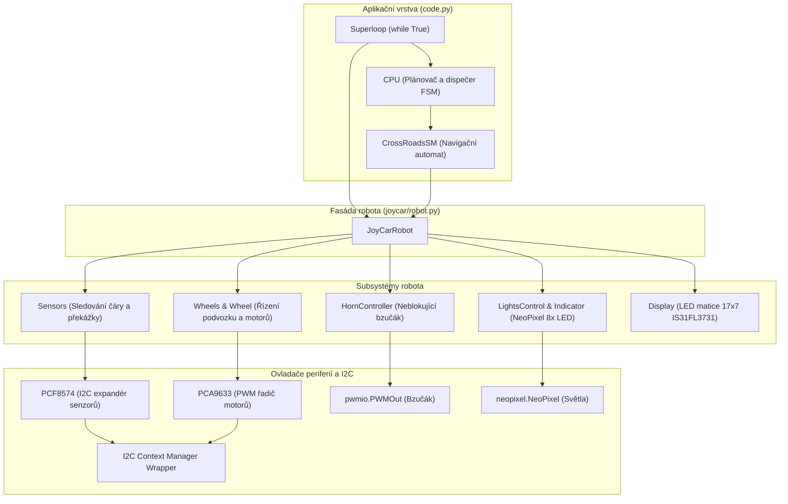

# JoyCar s Pico:ed – Vzorový výukový projekt řízení robota

Vzorový referenční projekt pro studenty kurzu **Základy stavby a programování robotů**.  
Běží na desce **Pico:ed v2** (Raspberry Pi RP2040) v prostředí **CircuitPython** na podvozku **Elecfreaks JoyCar**.

Projekt je navržen s důrazem na čistou modulární architekturu, objektové návrhové vzory, neblokující řízení (Superloop), deterministickou testovatelnost na PC a rozsáhlou výukovou dokumentaci (docstringy).

---

## 1. Architektura systému

Projekt využívá vrstvenou architekturu, kde je aplikační logika (stavový automat mise) oddělena od fyzického hardwaru prostřednictvím návrhového vzoru **Fasáda (Facade)**.



---

## 2. Klíčové principy a návrhové vzory pro studenty

### A. Vzor Superloop & zákaz blokujícího `sleep()`
V autonomní robotice **nesmíme používat blokující čekání** typu `time.sleep()`.
Při jízdě rychlostí 0.3 m/s by i krátké zpoždění 300 ms znamenalo, že robot ujede téměř 10 cm naslepo bez možnosti reagovat na křižovatku nebo překážku.

Celý projekt funguje jako **orchestr**:
- Hlavní smyčka v [code.py](file:///C:/Users/honza/OneDrive/R_D/Základy%20stavby%20a%20programování%20robotů/3-SW_GIT/code.py) neustále tiká:
  ```python
  while not button_a.was_pressed():
      CPU.tick()      # Krok logiky stavového automatu
      robot.update()  # Krok hardwaru (senzory, motory, světla, zvuk, displej)
      if log_period.ready():
          log.flush(5)
  ```
- Žádný subsystém neblokuje procesor; časování se řídí neblokujícími časovači `Timer` a `Period`.
- 📖 *Podrobné vysvětlení:* [superloop.md](file:///C:/Projekty/pomucky/superloop.md) a [sleep.md](file:///C:/Projekty/pomucky/sleep.md).

### B. Přesné časování přes `adafruit_ticks`
Místo funkce `time.monotonic()` (která v CircuitPythonu používá 32bitová plovoucí čísla float32 a po několika hodinách ztrácí přesnost na milisekundy) využíváme celočíselné funkce `ticks_ms()` a `ticks_diff()` z knihovny `adafruit_ticks`.
- 📖 *Podrobné vysvětlení:* [compare_tick_function.md](file:///C:/Projekty/pomucky/compare_tick_function.md).

### C. Návrhový vzor Fasáda (`JoyCarRobot`)
Třída `JoyCarRobot` v [joycar/robot.py](file:///C:/Users/honza/OneDrive/R_D/Základy%20stavby%20a%20programování%20robotů/3-SW_GIT/joycar/robot.py) sjednocuje všechny hardwarové komponenty robota do jednoho intuitivního rozhraní:
- `robot.rideLine(baseSpeed=0.2, turnGain=0.4)` – proporcionální sledování čáry.
- `robot.setVelocity(vMps, omegaRad)` – diferenciální kinematika dopředné a úhlové rychlosti.
- `robot.stop()` – bezpečné zastavení s rozsvícením brzdových světel.
- `robot.emergencyShutdown()` – okamžité nouzové odpojení motorů, světel i zvuku.
- `robot.playHonk(tutu)` – spuštění znělky na pozadí.

### D. Konečné stavové automaty (`joycar/sm.py`)
Kooperativní framework pro stavové automaty umožňuje definovat komplexní autonomní mise:
- `CPU`: Centrální dispečer a plánovač.
- `Task`: Stav s periodickým voláním těla.
- `Step`: Jednorázový krok s automatickým přechodem (`autoNext = True`).
- `AbstractSM`: Základní třída s fázemi `__krok__init()` $\rightarrow$ `__krok()` $\rightarrow$ `__krok__done()`.
- Podpora Python name-manglingu: metody pojmenované `__nazev` jsou korektně dohledány i po přejmenování kompilátorem.

### E. Bufferované logování bez zpoždění (`utils/log.py`)
Výpis na sériovou linku (`print`) přes USB je operace náročná na čas procesoru. Modul `utils.log` ukládá ladicí zprávy do paměťového bufferu (`log.info()`, `log.debug()`, `log.error()`).
V superloopu se zprávy dávkově odesílají pomocí `log.flush(max_line=5)`, což eliminuje zadrhávání robota.

---

## 3. Struktura repozitáře

```
3-SW_GIT/
├── code.py                 # Hlavní vstupní program spouštěný po zapnutí Pico:ed
├── code_joycar.py          # Samostatně spustitelná vzorová mise pro JoyCar
├── code_cutebot.py         # Archiv původního kódu pro platformu CuteBotPro
├── run_test.py             # Spouštěč kompletní testovací sady na PC (65 testů)
│
├── joycar/                 # Modulární balík robota JoyCar
│   ├── __init__.py         # Export veřejného API balíku
│   ├── robot.py            # Hlavní řídicí fasáda robota JoyCarRobot
│   ├── sensors.py          # Logika čáry, detekce křižovatek, debounce filtr
│   ├── sm.py               # Stavový automat (CPU, Task, Step, AbstractSM)
│   ├── navigation.py       # Řízení misí na křižovatkách (CrossRoadsSM, Commands)
│   ├── lights.py           # NeoPixel světelný subsystém (potkávací, blinkry, brzdy)
│   ├── sound.py            # Neblokující bzučák (HornController, HonkData, znělky)
│   ├── wheels.py           # Diferenciální podvozek (dva motory)
│   ├── wheel.py            # Řízení jednotlivého kola, deadzone, bezpečný reverz
│   ├── display.py          # Rychlý framebuffer ovladač LED matice 17x7
│   ├── pca9633.py          # Nízkoúrovňový I2C driver PWM čipu PCA9633
│   ├── pcf8574.py          # Nízkoúrovňový I2C expandér PCF8574
│   ├── i2c.py              # Zabezpečený I2C context manager (zamykání sběrnice)
│   ├── battery.py          # Měření napětí akumulátoru přes pin P2
│   └── direction.py        # Společná enumerace směrů (LEFT, RIGHT, FORWARD...)
│
├── utils/                  # Univerzální pomocné nástroje
│   ├── timer.py            # Jednorázový časovač Timer
│   ├── period.py           # Periodický časovač Period (s automatickým restartem)
│   └── log.py              # Bufferovaný logovací systém s časovými značkami
│
├── tests/                  # 15 testovacích modulů s 65 unit testy
│   ├── test_code_simulation.py     # Simulace životního cyklu code.py
│   ├── test_navigation.py          # Simulace kompletního průjezdu křižovatkou
│   ├── test_sound.py               # Test neblokujícího přehrávání tónů
│   ├── test_robot_integration.py   # Test propojení fasády robota
│   ├── test_lights.py              # Test časování světel a brzd
│   ├── test_sensors_line.py        # Test sledování čáry a debounce filtru
│   └── ...
│
├── _fake/                  # Simulovaný hardware pro deterministické testy na PC
└── _stubs/                 # Typové definice (stubs) pro CircuitPython API
```

---

## 4. Návod k použití a experimenty pro studenty

### A. Spuštění na fyzickém robotovi JoyCar
1. Připojte Pico:ed k počítači přes USB kabel.
2. V systému se objeví disková jednotka `CIRCUITPY`.
3. Zkopírujte obsah této složky (`joycar/`, `utils/`, `code.py`) do kořene disku `CIRCUITPY`.
4. Robot se po uložení automaticky restartuje:
   - Zobrazí napětí baterie na čelním LED displeji.
   - Zahraje uvítací znělku `hello`.
   - Rozsvítí potkávací světla a vyrazí po čáře.
5. Stiskem tlačítka **A** na desce Pico:ed robota kdykoliv bezpečně zastavíte.

### B. Zadání vlastní navigační trasy křižovatek
V souboru [code.py](file:///C:/Users/honza/OneDrive/R_D/Základy%20stavby%20a%20programování%20robotů/3-SW_GIT/code.py) můžete změnit itinerář v proměnné `route`:

```python
from joycar import Commands, DirectionEnum

# Příklad: trasa se střídavým odbočováním
route = Commands([
    DirectionEnum.LEFT,
    DirectionEnum.FORWARD,
    DirectionEnum.RIGHT,
    DirectionEnum.LEFT,
])
```

### C. Jednoduché sledování čáry bez křižovatek
Pokud nepotřebujete křižovatkový automat a chcete pouze plynule projíždět trať:

```python
from joycar import createJoyCarRobot
from picoed import button_a

robot = createJoyCarRobot()

while not button_a.was_pressed():
    # baseSpeed: základní rychlost v m/s, turnGain: citlivost zatáčení
    robot.rideLine(baseSpeed=0.2, turnGain=0.4)
    robot.update()

robot.stop()
```

### D. Tvorba vlastních melodií a znělek
V modulu [joycar/sound.py](file:///C:/Users/honza/OneDrive/R_D/Základy%20stavby%20a%20programování%20robotů/3-SW_GIT/joycar/sound.py) můžete definovat vlastní melodii pomocí třídy `HonkData`:

```python
from joycar.sound import HonkData

moje_melodie = HonkData(
    tones=[523, 659, 784, 1046],    # Tóny C5, E5, G5, C6 v Hz
    durations=[150, 150, 150, 300],  # Délka každého tónu v ms
    pauses=[50, 50, 50, 100]         # Mezera ticha za každým tónem v ms
)

robot.playHonk(moje_melodie)
```

---

## 5. Vývoj a unit testy na PC (bez hardwaru)

Projekt obsahuje kompletní stub/fake vrstvu (`_fake/`), která simuluje CircuitPython periferie (`busio.I2C`, `pwmio.PWMOut`, `picoed`, `adafruit_ticks`) v paměti na libovolném PC s běžným Pythonem 3.

### Spuštění všech testů
V kořenovém adresáři projektu spusťte:

```bash
python run_test.py
```

Výstup testovací sady:
```
Ran 65 tests in 0.015s
OK
ALL TESTS PASSED ✔
```

Testy ověřují všechny situace:
- Správnost výpočtu odchylky od čáry a debounce filtr při přejezdu přerušované čáry.
- Nezávislé časování blikání blinkrů i automatické zhasnutí brzdových světel.
- Neblokující běh zvukových sekvencí po milisekundách.
- Ošetření deadzone motorů a zamezení proudovým rázům při prudkém reverzu.
- Kompletní simulaci autonomní mise robota na křižovatce.

---

## 6. Odkazy na studijní pomůcky

Veškeré teoretické podklady a vysvětlující texty pro studenty naleznete v lokálním repozitáři pomůcek:
- [superloop.md](file:///C:/Projekty/pomucky/superloop.md) – Metafora šéfkuchaře a orchestru: proč autonomní robot nesmí používat blokující `sleep()`.
- [compare_tick_function.md](file:///C:/Projekty/pomucky/compare_tick_function.md) – Proč používáme `adafruit_ticks` místo `time.monotonic()`.
- [sleep.md](file:///C:/Projekty/pomucky/sleep.md) – Rozdíl v blokování procesoru mezi MicroPythonem a CircuitPythonem.
